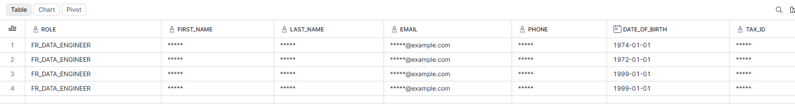
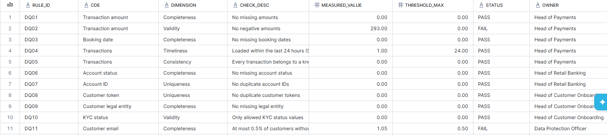
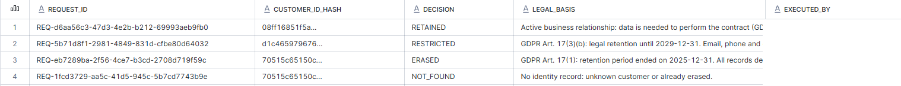

# Snowflake governance for a neobank

Data governance as code for a fictional neobank on Snowflake: who can see personal data, how it is
deleted on request, and how critical numbers are checked.

> **Status:** phase 1 (governance core) is built and tested in a Snowflake Enterprise account.
> The dbt layer and CI/CD are next (see [Roadmap](#roadmap)).

## Why

A bank has to be able to prove three things about its data:

1. **Only the right people see personal data**, and there is a record of who looked at what.
2. **A customer can be forgotten** (GDPR Article 17), except where the law requires the bank to keep
   records, for example for anti-money-laundering checks.
3. **Its critical numbers can be trusted**: each one has an owner, a definition and automated quality
   checks (the BCBS 239 principles for risk data).

This project builds those controls in Snowflake as version-controlled SQL and YAML files, not as manual
settings in a user interface. The same scripts can be reviewed, rerun and audited.

## What it shows

| Governance need | How it is solved | File |
|---|---|---|
| Separate zones with the right retention | Transient raw zone; managed-access core and governance zones; Time Travel set per zone | [`00_setup.sql`](sql/00_setup.sql) |
| Realistic test data, with known defects | 10,000 synthetic customers, 13,316 accounts, 300,000 transactions, 30,000 consents | [`01_synthetic_data.sql`](sql/01_synthetic_data.sql) |
| Personal data in one place only | Pseudonymisation at ingestion: random tokens, identity vault, minimised core tables | [`02_pseudonymisation.sql`](sql/02_pseudonymisation.sql) |
| Access by job, not by person | Access roles combined into functional roles; separation of duties | [`03_roles.sql`](sql/03_roles.sql) |
| Know where personal data sits | Object tags plus Snowflake's automatic classification as a cross-check | [`04_classification.sql`](sql/04_classification.sql) |
| Only authorised roles see personal data | Tag-based masking policies; approved roles kept in a table | [`05_masking.sql`](sql/05_masking.sql) |
| Staff see only their own entity's data | Row access policy by legal entity | [`06_row_access.sql`](sql/06_row_access.sql) |
| Critical numbers are checked | 11 rules on Critical Data Elements, logged daily; data metric functions | [`07_data_quality.sql`](sql/07_data_quality.sql) |
| Right to be forgotten | Erasure procedure with legal retention rules and an audit log | [`08_erasure.sql`](sql/08_erasure.sql) |
| Evidence for auditors | Who can see PII, policy coverage, access history, proof of erasure, re-identification risk | [`09_audit_queries.sql`](sql/09_audit_queries.sql) |
| Owners and rules for critical data | CDE register and ownership per data product | [`governance/`](governance) |
| Producers and consumers agree on the data | Data contracts, each promise mapped to the control that enforces it | [`governance/data_contracts/`](governance/data_contracts) |

## Results

Same query, different role. A data engineer sees masked personal data:



The privacy officer sees the real values ([screenshot](docs/screenshots/05_masking_privacy_officer.jpg)).
The German analyst sees only the German entity's 4,991 customers, the EU analyst only the other 5,009
([DE](docs/screenshots/06_row_access_analyst_de.jpg), [EU](docs/screenshots/06_row_access_analyst_eu.jpg)).

Data quality on Critical Data Elements. The two failures are the defects seeded on purpose:



Erasure requests, each with its decision and legal basis. The log holds a hash, never the customer ID:



More evidence: [policy coverage](docs/screenshots/09_policy_coverage.jpg) (19 personal-data columns
masked, row access on 3 tables, all active), [proof of erasure](docs/screenshots/09_proof_of_erasure.jpg)
and [re-identification risk and retention backlog](docs/screenshots/09_reidentification_and_retention.jpg).

## Architecture

```
            RAW (transient)                 GOVERNANCE (managed access)            CORE (managed access)
   customers, accounts, transactions  ──►  customer_identity  (identity vault) ──►  customers, accounts,
   consents: real identifiers,             erasure_log, retention_rules           transactions, consents:
   masked for everyone but the pipeline    pii_access, legal_entity_access        tokens only, rows filtered
                                           dq_rules, dq_results                   by legal entity
```

| Role | Can do | Cannot do |
|---|---|---|
| `FR_ANALYST_DE` / `FR_ANALYST_EU` | Read core, own legal entity only | See raw, the vault, or the other entity |
| `FR_DATA_ENGINEER` | Read raw and core | See personal data unmasked |
| `FR_PRIVACY_OFFICER` | Read the vault, run erasure requests | Delete data directly |
| `FR_AUDITOR` | Read governance tables, logs and Snowflake's governance views | Read customer data |
| `GOVERNANCE_ADMIN` | Own tags and policies, apply them to any table | Read customer data |
| `SYSADMIN` | Own the data objects, run the pipeline (needs real values to fill the vault) | Change the masking or row access policies |

## Key design decisions

- **Retention per zone.** Raw is transient (no Fail-safe, 1 day Time Travel), so personal data deleted
  there is gone after a day; raw can be reloaded from the source. Core keeps 7 days of Time Travel to
  recover from bad loads. The vault keeps 1 day, so an erased customer's row stops being restorable
  quickly.
- **Managed-access schemas.** Only the schema owner or SECURITYADMIN can grant access to tables in
  core and governance, not whoever created a table. Access is controlled in one place.
- **Random tokens, not hashes.** A hash of a customer ID can be recomputed by anyone who knows the ID.
  A random UUID cannot, so deleting the vault row really breaks the link.
- **Loads keep governance settings.** Core tables are reloaded with `INSERT OVERWRITE`, not
  `CREATE OR REPLACE`, which would drop their tags and policies.
- **Policies attach to tags.** Tagging a column as personal data is what protects it. New columns are
  covered as soon as they are tagged.
- **Entitlements live in tables.** Who may see personal data and which entity's rows is stored in
  `pii_access` and `legal_entity_access`. A change is a reviewed row, not a code change, and auditors
  can read it.
- **Policies check the primary role only.** Secondary roles can never widen access to personal data.
- **Automatic classification is a cross-check, not the decision.** Snowflake found 5 identifier
  columns, all already tagged. It missed 4 that we tagged (phone, street address, two IBANs).
- **Erasure is a decision, not a delete.** Active customers are retained, customers inside a legal
  retention period are restricted with contact data erased, and only customers past retention are
  fully erased. Details in [right_to_be_forgotten.md](governance/right_to_be_forgotten.md).
- **Checks are designed to fail.** Defects are seeded in the data, and the quality checks catch them.

## How to run it

Requirements: a Snowflake account on **Enterprise edition** (a free trial works), because masking,
row access policies, tags, data metric functions and access history are Enterprise features.

1. Run `sql/00_setup.sql` to `sql/08_erasure.sql` in order, each as a whole script in a Snowflake
   worksheet. Each script switches to the roles it needs and ends with a check.
2. Run the queries in `sql/09_audit_queries.sql` one at a time.

Notes:
- `01_synthetic_data.sql` rebuilds the raw tables. Rerun `04_classification.sql` after it to restore
  the tags.
- Views in `SNOWFLAKE.ACCOUNT_USAGE` (used in Q1, Q3 and Q4) lag behind by up to a few hours.
- The scripts use an XSMALL warehouse with a monthly credit cap.

## Data

All data is synthetic and generated inside Snowflake. There is no real customer data in this project.
Fake IBANs use check digits `00`, which can never be valid. Defects are added on purpose (about 1%
missing emails and 0.1% negative amounts) so the quality checks have something to find.

## Limits

- Retention periods are summarised from the laws named in `08_erasure.sql` and would need confirming
  by Legal. The longest period is applied to the whole customer record.
- Notifying source and downstream systems about erasures is described, not built.
- Some data contract promises (allowed values) are documented but not yet tested; they become dbt
  tests in phase 2.

## Roadmap

1. **Governance core** in Snowflake SQL and YAML. *Done.*
2. **dbt layer**: staging, intermediate and mart models with enforced contracts; tags and masking
   applied from configuration with Jinja macros; grants as code; tests and lineage.
3. **CI/CD**: SQL linting and dbt checks in GitHub Actions, an architecture diagram, and a map from
   regulations (GDPR, BCBS 239, DORA) to the controls in this repo.
